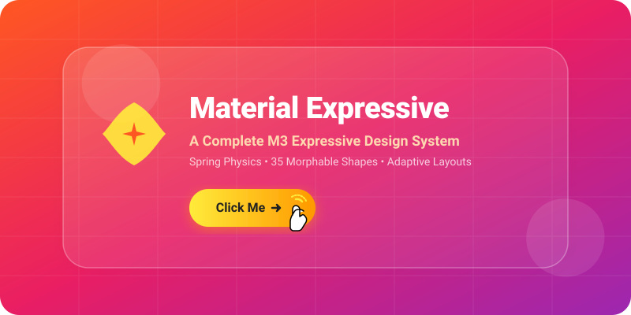

# Material Expressive

A complete **Material 3 Expressive** design system for Flutter.

This is not a widget library. It's a design system that enhances Flutter's existing Material widgets through tokens, spring physics, 35 morphable shapes, vibrant colors, emphasized typography, and expressive component behaviors.

Inspired by Google's M3 Expressive redesign announced at I/O 2025.

<p align="center">
  <a href="https://github.com/Najeer-k11/material_expressive">
    
  </a>
</p>

---

## Installation

```yaml
dependencies:
  material_expressive: ^0.10.0
```

```dart
import 'package:material_expressive/material_expressive.dart';
```

---

## Getting Started

### 1. Generate a theme

```dart
final theme = ExpressiveThemeData.fromSeed(
  seedColor: Colors.deepOrange,
  shapeType: ExpressiveShapeType.organic,
);
```

### 2. Apply to your app

```dart
MaterialApp(
  theme: ExpressiveComponentThemes.apply(theme.materialTheme),
  darkTheme: ExpressiveComponentThemes.apply(theme.materialDarkTheme),
  builder: (context, child) => ExpressiveTheme(
    data: theme,
    child: child!,
  ),
);
```

### 3. Access tokens anywhere

```dart
context.tokens.spacing.lg      // spacing scale from the theme
context.tokens.colors.primary  // semantic color
context.tokens.radius.md       // corner radius
context.tokens.shape.lg        // ShapeBorder
context.adaptiveSpacing.xl     // auto phone/tablet/desktop
context.windowSizeClass        // compact / medium / expanded / ...
```

`ExpressiveTheme.of(context)` (and `context.tokens`) falls back to standard
tokens when no `ExpressiveTheme` is in the tree. Package components read
their default radii, spacing and durations from it, so a custom
`ExpressiveThemeData` restyles them too.

```dart
```

---

## Sub-libraries

Import only what you need:

| Import                     | Contents                                                                 |
| -------------------------- | ------------------------------------------------------------------------ |
| `material_expressive.dart` | Everything                                                               |
| `tokens.dart`              | Design tokens (colors, spacing, radius, elevation, motion, typography)   |
| `shapes.dart`              | 35 ExpressiveShapes + morphing + RTL                                       |
| `motion.dart`              | Spring physics, ExpressiveMotionScheme, transitions, gesture spring, accessibility |
| `theme.dart`               | ExpressiveTheme / ExpressiveThemeData, vibrant colors, harmonization     |
| `components.dart`          | Widgets + ExpressiveComponentThemes                                      |
| `core.dart`                | Context extensions, adaptive utilities, layout helpers                   |
| `devtools.dart`            | Spacing overlay, token inspector                                         |

---

## Shapes (35 total)

All official M3 Expressive shapes, each defined as interpolatable points:

```dart
// Use as static decoration
Container(
  decoration: ShapeDecoration(
    shape: ExpressiveMorphableShapeBorder(points: ExpressiveShapes.heart),
    color: Colors.pink,
  ),
)

// Animate between shapes
ExpressiveShapeMorph(
  shape: ExpressiveShapes.flower,  // change this → smooth morph
  size: 80,
  color: scheme.primary,
  duration: Duration(milliseconds: 500),
)

// RTL-aware
ExpressiveRtlShapes.directional(context, ExpressiveShapes.arrow)
```

**All shapes:** circle, square, pill, diamond, triangle, pentagon, arch, arrow, heart, flower, clover4Leaf, clover8Leaf, cookie4/6/7/9/12Sided, boom, softBoom, burst, softBurst, sunny, verySunny, fan, gem, ghostish, bun, oval, puffy, puffyDiamond, semiCircle, slanted, pixelCircle, pixelTriangle, clamShell.

---

## Spring Physics (ExpressiveMotionScheme)

Two predefined schemes matching M3 Expressive motion tokens:

```dart
// Standard — subtle, functional transitions
ExpressiveMotionScheme.standard.defaultSpatial
ExpressiveMotionScheme.standard.fastEffects

// Expressive — bouncy, engaging hero interactions
ExpressiveMotionScheme.expressive.defaultSpatial  // stiffness: 380, damping: 0.73
ExpressiveMotionScheme.expressive.fastSpatial

// Use on any AnimationController
controller.animateWithSpring(
  ExpressiveMotionScheme.expressive.defaultSpatial,
  target: 1.0,
);

// Per-component assignments
ExpressiveComponentMotion.hero       // expressive scheme
ExpressiveComponentMotion.navigation // standard scheme
ExpressiveComponentMotion.dialog     // expressive.fastSpatial
ExpressiveComponentMotion.button     // standard.fastSpatial
```

### ExpressiveSpringTransition widget

```dart
ExpressiveSpringTransition(
  isActive: _expanded,
  spring: ExpressiveMotionScheme.expressive.defaultSpatial,
  scaleActive: 1.3,
  scaleInactive: 1.0,
  child: myWidget,
)
```

### Gesture-driven spring

```dart
ExpressiveGestureSpringBox(
  spring: ExpressiveMotionScheme.expressive.defaultSpatial,
  axis: Axis.vertical,
  maxOffset: 100,
  snapBack: true,
  child: Card(...),
)
```

### Accessibility

```dart
// Respects system "reduce motion" setting
final spring = ExpressiveMotionAccessibility.adaptiveSpring(
  context, ExpressiveMotionScheme.expressive.defaultSpatial);
final dur = ExpressiveMotionAccessibility.adaptiveDuration(
  context, Duration(milliseconds: 400));
```

---

## Vibrant Colors

M3 Expressive uses more saturated palettes than standard Material You:

```dart
// Vibrant scheme (boosted saturation)
final scheme = ExpressiveVibrantColorScheme.fromSeed(
  seedColor: Colors.blue,
  saturationBoost: 0.2,
);

// Harmonize brand colors with your theme
final brandRed = ExpressiveColorHarmonization.harmonize(
  myBrandRed, seedColor, amount: 0.25);

// Generate all semantic colors at once
final semantic = ExpressiveColorHarmonization.harmonizeAll(
  seed: seedColor,
  success: Colors.green,
  warning: Colors.orange,
  info: Colors.blue,
  error: Colors.red,
);
```

---

## Expressive Typography

```dart
// Apply emphasis (bolder, larger headlines)
final textTheme = ExpressiveTypography.emphasized(
  base.textTheme,
  emphasisLevel: 0.6, // 0.0 = standard, 1.0 = max
);

// Variable font axes (if font supports it)
Text('Hello', style: ExpressiveTypography.withVariableAxes(
  baseStyle,
  weight: 700,
  opticalSize: 48,
));
```

---

## Components

### Button Group

```dart
ExpressiveButtonGroup(
  buttons: [
    ExpressiveButtonGroupItem(label: 'Day', icon: Icons.today),
    ExpressiveButtonGroupItem(label: 'Week'),
    ExpressiveButtonGroupItem(label: 'Month'),
  ],
  selectedIndex: _selected,
  onSelected: (i) => setState(() => _selected = i),
)
```

### Split Button

```dart
ExpressiveSplitButton(
  label: 'Save',
  icon: Icons.save,
  onPressed: _save,
  onDropdown: _showOptions,
)
```

### Floating Toolbar

```dart
ExpressiveFloatingToolbar(items: [
  ExpressiveFloatingToolbarItem(icon: Icons.format_bold, isSelected: true, onPressed: () {}),
  ExpressiveFloatingToolbarItem(icon: Icons.format_italic, onPressed: () {}),
  const ExpressiveFloatingToolbarItem.divider(),
  ExpressiveFloatingToolbarItem(icon: Icons.link, onPressed: () {}),
])
```

### Carousel

```dart
ExpressiveCarousel(
  height: 200,
  viewportFraction: 0.85,
  items: [Card(...), Card(...), Card(...)],
)
```

### Search Bar (morph expand)

```dart
ExpressiveSearchBar(
  controller: _searchCtrl,
  hintText: 'Search...',
  onChanged: (q) {},
)
```

### Bottom Sheet

```dart
showExpressiveBottomSheet(
  context: context,
  snap: true,
  snapSizes: [0.25, 0.5, 0.9],
  builder: (_) => MyContent(),
);
```

### Dialog

```dart
showExpressiveDialog(
  context: context,
  builder: (_) => ExpressiveAlertDialog(
    icon: Icon(Icons.warning),
    title: Text('Discard changes?'),
    content: Text('Your edits will be lost.'),
    actions: [
      TextButton(onPressed: () {}, child: Text('Cancel')),
      FilledButton(onPressed: () {}, child: Text('Discard')),
    ],
  ),
);
```

### Snackbar

```dart
showExpressiveSnackBar(context,
  message: 'File saved',
  icon: Icons.check_circle,
  actionLabel: 'Undo',
  onAction: _undo,
);
```

### State Morph Container

```dart
ExpressiveStateMorphContainer(
  isActive: _selected,
  activeShape: ExpressiveShapes.circle,
  inactiveShape: ExpressiveShapes.square,
  spring: ExpressiveMotionScheme.expressive.defaultSpatial,
  child: Icon(Icons.star),
)
```

### Shape Container Transform

```dart
ExpressiveShapeContainerTransform(
  closedShape: ExpressiveShapes.circle,
  closedSize: 56,
  closedBuilder: (ctx, open) => IconButton(icon: Icon(Icons.add), onPressed: open),
  openBuilder: (ctx, close) => DetailScreen(onBack: close),
)
```

---

## Loading Indicators

```dart
ExpressiveContainedLoadingIndicator(segments: 4)   // M3 Expressive segmented arc
ExpressiveWavyLinearProgressIndicator(value: 0.6)  // wavy determinate linear
ExpressiveWavyLinearProgressIndicator()            // wavy indeterminate linear
ExpressiveWavyCircularProgressIndicator(value: 0.4) // wavy determinate circular
ExpressiveWavyCircularProgressIndicator()          // wavy indeterminate circular
ExpressiveOrganicLoadingIndicator()                 // blob animation
ExpressivePulsingDotsIndicator()                    // pulsing dots
ExpressiveMorphingShapeIndicator()                  // morphing shape
```

---

## Surfaces

```dart
ExpressiveSurface(
  type: ExpressiveSurfaceType.primaryTinted,
  padding: EdgeInsets.all(16),
  child: Text('Tinted surface'),
)
```

Types: `surface`, `containerLow`, `container`, `containerHigh`, `primaryTinted`, `secondaryTinted`, `tertiaryTinted`.

---

## Expressive Icons

Standard `Icons.*` work as-is. This adds the **M3 Expressive presentation** — shaped containers, sizing, optical adjustments:

```dart
// Icon in a shaped container
ExpressiveIcon(Icons.favorite,
  size: ExpressiveIconSize.large,
  shapeType: ExpressiveShapeType.organic,
  backgroundColor: scheme.primaryContainer,
  foregroundColor: scheme.onPrimaryContainer,
)

// Small contained icon with tap
ExpressiveIcon(Icons.add,
  size: ExpressiveIconSize.small,
  filled: true,
  onPressed: () {},
)

// Apply expressive icon theme globally
IconTheme(
  data: ExpressiveComponentThemes.iconTheme(scheme: scheme),
  child: ...,
)
```

> **Tip:** For the latest Material Symbols variable font icons, pair this package
> with [material_symbols_icons](https://pub.dev/packages/material_symbols_icons).
> `ExpressiveComponentThemes.iconTheme` sets `opticalSize`, `weight`, `grade`, and `fill`
> which variable icon fonts respond to.

---

## Theme Extensions

Apply expressive styling to all standard Material widgets at once:

```dart
final expressiveTheme = ExpressiveComponentThemes.apply(
  theme.materialTheme,
  coloredAppBar: true,
);
```

Or apply individually. Each method is named after the `ThemeData` field it fills:

- `floatingActionButtonTheme(scheme:)` — organic-shaped FAB
- `navigationBarTheme(scheme:)` — taller nav with bold labels
- `appBarTheme(scheme:, colored:)` — bolder title
- `iconButtonTheme(scheme:)` — larger touch targets
- `cardTheme(scheme:)` — tonal rounded cards
- `iconTheme(scheme:, filled:)` — variable-font icon axes
- `sliderTheme`, `switchTheme`, `checkboxTheme`, `radioTheme`, `datePickerTheme`,
  `timePickerTheme`, `tooltipTheme`, `popupMenuTheme`, `progressIndicatorTheme`

---

## Dev Tools

```dart
// Spacing grid overlay
ExpressiveSpacingOverlay(enabled: kDebugMode, child: MyApp())

// Token inspector drawer
Scaffold(endDrawer: ExpressiveTokenInspector())
```

---

## License

MIT
